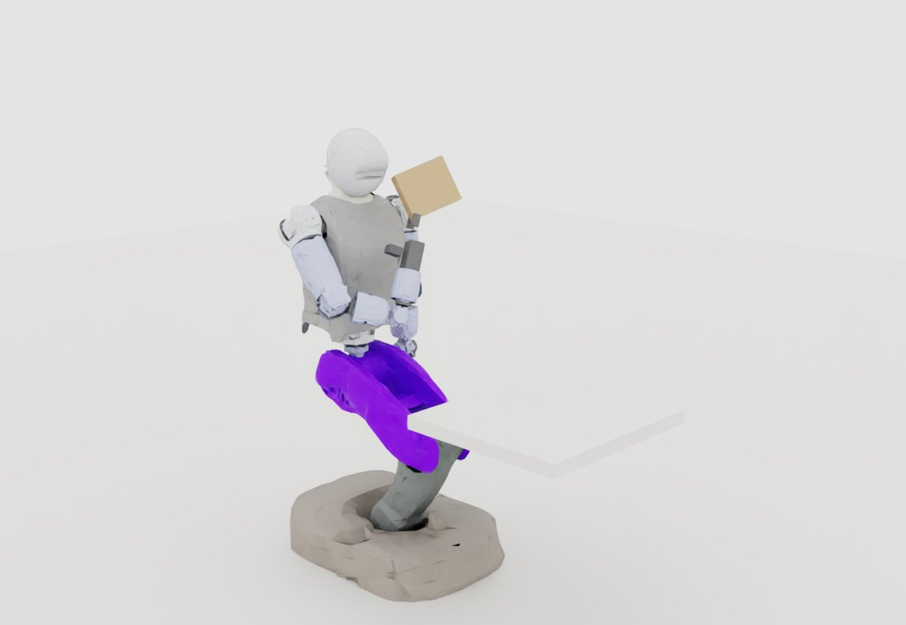
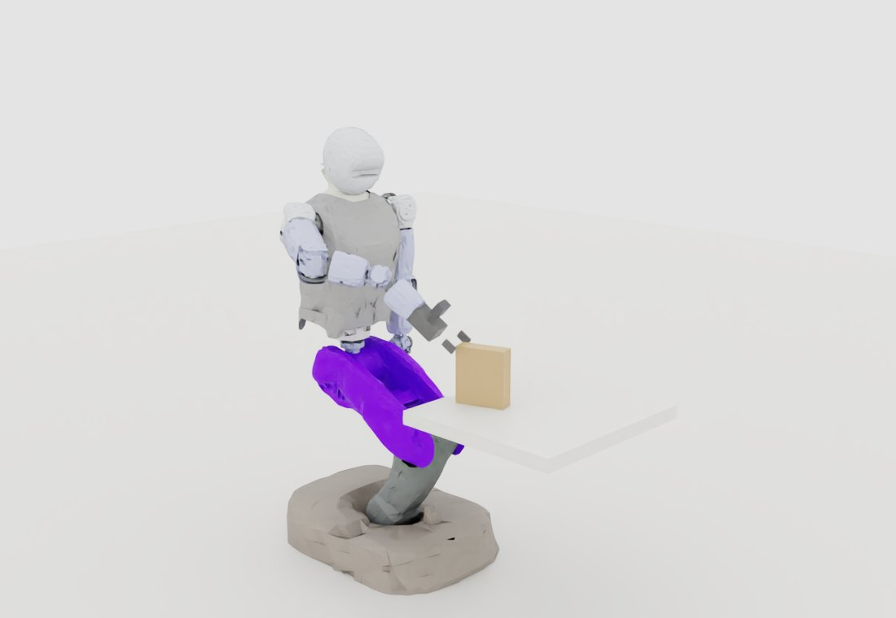

# YMBot-D 4090 抓取仿真与 ACT 工程

用 K3 真机记录在 RTX 4090 上复现纸箱抓取、抬升、放回和撤离。机器人、二指夹爪、桌面、纸箱和头腕相机通过 USD 组织，物理回放使用 Isaac Lab 的 CUDA MJWarp 管理器。

| 入口 | 内容 |
|---|---|
| [4090 验收手册](4090_ACCEPTANCE_GUIDE.md) | 登录、预览、复现单例和五例、评分 |
| [逐文件说明](docs/FILES.md) | 各提交文件的用途和关联入口 |
| [数据和工作进度](docs/DATA_AND_RESULTS.md) | 数据位置、备份范围、结果来源和提交里程碑 |
| [K3 技术记录](K3_SIM2REAL.md) | 真机标定、接触诊断、求解参数和对照实验 |
| [ACT 路线图](4090_ACT_ROADMAP.md) | 可重置任务、双相机数据、ACT 训练和实机联调 |

## 当前结果

4090 在 360 Hz、椭圆摩擦锥、阻抗比 800 下通过五例回放验收。#17 复现抓空，#18–#21 保持到开爪并稳定放回，平面偏差分别为 **7.57、6.23、8.19、7.17 mm**。这次验收的位置误差阈值为 20 mm，撤离后箱体移动阈值为 2 mm。[原评分](docs/results/score_all.json)

| #21 抬升 | #21 放回 |
|---|---|
|  |  |

当前成果覆盖现场轨迹驱动的物理回放。下一阶段是做一个可重置、能接收新动作的抓取任务，再接几何专家和 ACT。

## 在 4090 复现 #21

需要先有 IsaacLab 环境和 K3 数据备份。下面使用已验证的 4090 工作目录。更换路径时先按 [数据和工作进度](docs/DATA_AND_RESULTS.md) 核对 USD 引用。

```bash
cd /home/nvidia4090/ymbot_grasp
export OMNI_KIT_ACCEPT_EULA=YES
PY=/home/nvidia4090/IsaacLab/.venv/bin/python
D=/home/nvidia4090/real_data/k3_20261120
S="$D/validation/pad_patch_grid/torsional"
OUT=$(mktemp -d "$D/validation/acceptance_XXXXXX")

"$PY" -B tools/replay_k3_grasp.py "$S/trial_21.usda" "$D/derived/trial_21" "$OUT/dynamics_21.json" \
  --isaaclab --device cuda:0 --physics-hz 360 --cone elliptic --contact-impratio 800 \
  --arm-bias-compensation --sample-contacts --through-release \
  --usd-animation "$OUT/K3_Trial21_Replay.usda"
"$PY" -B tools/check_k3_placement.py "$D/derived" "$OUT/score_21.json" "$OUT/dynamics_21.json" \
  --max-placement-error-mm 20 --max-rest-motion-mm 2 --require-pass
```

查看 `score_21.json` 的 `passed` 和逐项 `checks`。完整验收按 [验收手册](4090_ACCEPTANCE_GUIDE.md) 再运行 #17–#20，生成新的 `score_all.json`。

## 项目布局

- `assets/` 保存机器人 USD、纹理和早期桌面演示。演示入口是 `assets/scene_table_box.usda`。
- `tools/` 保存数据准备、标定、场景生成、仿真、评分和预览入口。
- `docs/` 保存逐文件索引和小型验收证据。完整原始归档和生成实验数据位于 [既有备份](docs/DATA_AND_RESULTS.md)。
